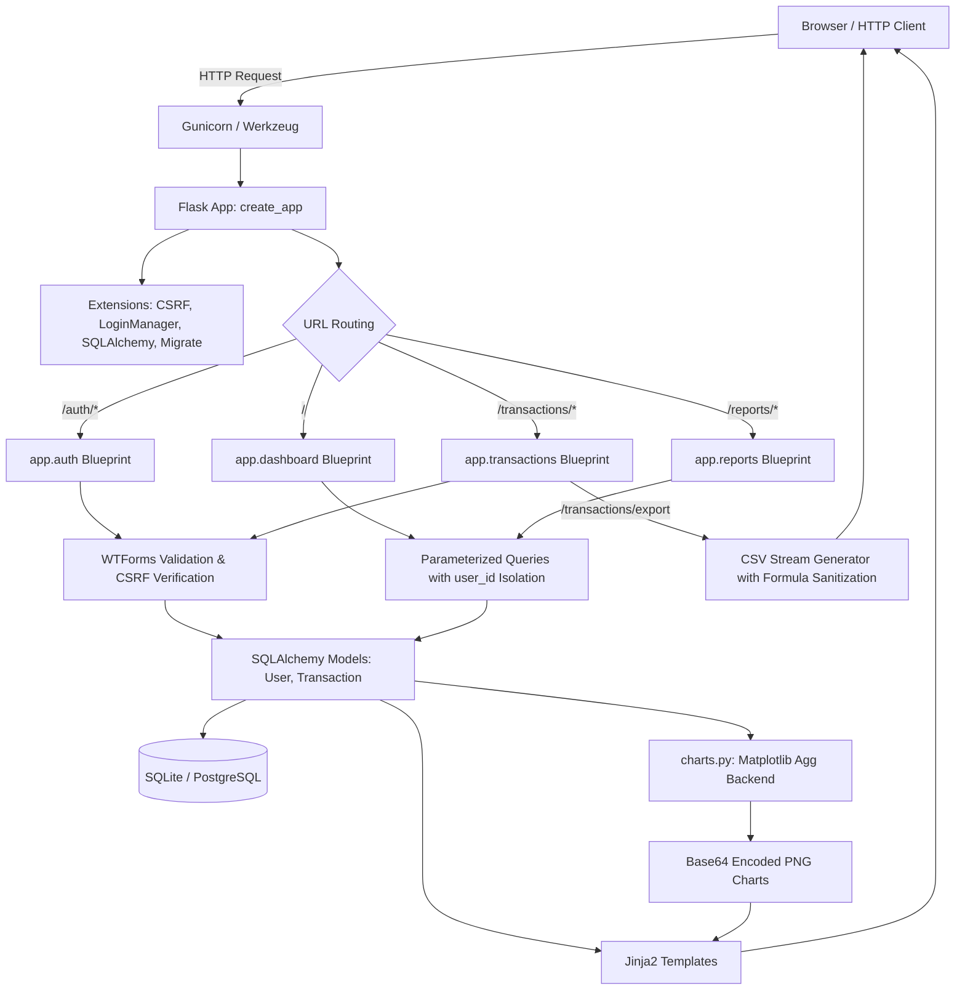

# Smart Spend — Expense Tracker: Comprehensive Technical Audit Report

**Date of Audit:** October 22, 2026  
**Auditor Roles:** Senior Python/Flask Developer, QA Automation Engineer, Software Architect, Technical Documentation Specialist  
**Project Location:** `C:\Users\yashi\Desktop\Expense Tracker`  
**Current Branch:** `main` (clean working tree modifications prepared for commit)  
**Python Runtime:** Python 3.12.5 (Windows x64)

---

## A. Executive Summary

### 1. Project Purpose
**Smart Spend** is a production-grade, modular personal finance web application built in Python and Flask. It is engineered to give individuals clear, reliable control over daily cash flows, financial categorization, monthly net savings calculations, and exportable financial reports without spreadsheet complexity or cluttered third-party tooling.

### 2. Current Implementation Status
The project adheres strictly to the approved core scope:
1. **Authentication**: User signup, login, session management, logout, and salted password hashing.
2. **Transactions CRUD**: Full lifecycle management (Add, View, Edit, Delete) with search, filtering, and sorting.
3. **Dashboard with Analytics**: Real-time KPI summaries (Total Income, Total Expenses, Net Savings), Matplotlib category pie charts, and monthly income vs. expense bar charts.
4. **Reports and CSV Export**: Dedicated report review with formula injection defense and strict user-specific export isolation.
5. **Automated Testing**: 17 automated tests passing with zero failures.

All out-of-scope features (shared expense splitting, statement import/parsing, budgets, savings goals, and recurring expenses) have been verified completely absent from active application source code, models, templates, routes, and navigation elements.

### 3. Readiness Assessment
- **Portfolio & GitHub Readiness**: **HIGH / PRODUCTION-READY**
- **Interview Presentation Readiness**: **EXCELLENT** (Clear application factory pattern, zero circular imports, isolated multi-tenant database queries, defensive CSV sanitization, and idempotent demo data generation).

---

## B. Complete Project Inventory

```text
Expense Tracker/
├── app/
│   ├── __init__.py                # Flask application factory (create_app)
│   ├── config.py                  # Environment-specific configuration classes
│   ├── extensions.py              # Centralized extensions (db, migrate, login_manager, csrf)
│   ├── core/
│   │   ├── errors.py              # Custom HTTP error handlers (400, 403, 404, 500)
│   │   └── security.py            # CSV sanitization & safe redirect validation
│   ├── models/
│   │   ├── __init__.py            # Model exports (User, Transaction, CATEGORIES)
│   │   ├── user.py                # User model & password hashing
│   │   └── transaction.py         # Numeric(12,2) Transaction model
│   ├── auth/
│   │   ├── __init__.py            # Blueprint definition (auth_bp)
│   │   ├── forms.py               # WTForms: SignupForm, LoginForm, ProfileForm, ChangePasswordForm
│   │   └── routes.py              # Endpoints: /signup, /login, /logout, /profile
│   ├── dashboard/
│   │   ├── __init__.py            # Blueprint definition (dashboard_bp)
│   │   └── routes.py              # Overview KPI calculations, filtering & chart rendering
│   ├── transactions/
│   │   ├── __init__.py            # Blueprint definition (transactions_bp)
│   │   ├── forms.py               # WTForms: TransactionForm with decimal validation
│   │   └── routes.py              # CRUD endpoints, search, pagination, CSV export, legacy claim
│   ├── reports/
│   │   ├── __init__.py            # Blueprint definition (reports_bp)
│   │   └── routes.py              # Monthly report analytics & charts
│   └── templates/
│       ├── auth/                  # login.html, signup.html, profile.html
│       ├── dashboard/             # index.html (dashboard), landing.html (unauthenticated)
│       ├── reports/               # summary.html
│       ├── transactions/          # index.html, add.html, edit.html
│       └── base.html              # Responsive layout with CSRF meta tags & flash alerts
├── migrations/
│   ├── versions/                  # Alembic migration revisions
│   ├── alembic.ini                # Alembic configuration
│   └── env.py                     # Migration environment script
├── static/
│   ├── vendor/                    # Local offline vendor assets (Bootstrap 5, Bootstrap Icons)
│   ├── app.js                     # Table sorting, interactive UI utilities
│   ├── style.css                  # Modern theme stylesheet
│   └── favicon.ico                # Application favicon
├── tests/
│   ├── conftest.py                # Pytest fixtures with in-memory SQLite isolation
│   ├── test_architecture_and_demo.py # Factory blueprint audit & idempotent demo seeder tests
│   ├── test_auth.py               # Signup, duplicate rejection, login, logout tests
│   ├── test_authorization.py      # Multi-tenant data isolation & IDOR prevention tests
│   ├── test_dashboard_and_analytics.py # Cash flow calculations, date filters, empty states
│   ├── test_transactions_and_export.py # Full CRUD, CSV export sanitization & user isolation
│   └── test_validation_and_flash.py    # Form validation & negative amount prevention
├── docs/
│   ├── screenshots/               # Directory for application screenshots
│   └── PROJECT_AUDIT_REPORT.md    # This technical audit report
├── demo_seed.py                   # Safe, idempotent demo seeder (40 transactions across 4 months)
├── requirements.txt               # Locked canonical dependencies
├── run.py                         # Production application entry point
├── app.py                         # Backwards-compatible entry point & shell context
├── charts.py                      # Matplotlib base64 chart generator
├── seed.py                        # Safe development database seeder
├── migrate_legacy.py              # Non-destructive legacy database upgrade helper
├── pytest.ini                     # Pytest configuration
├── .env.example                   # Environment variable template
└── .gitignore                     # Comprehensive git ignore rules
```

### Detailed Component Inventory Table

| Component / File | Type | Status | Purpose | Dependencies |
|---|---|---|---|---|
| `run.py` | Python Script | Active | Canonical application entry point | `app.create_app` |
| `app.py` | Python Script | Active | Backwards-compatibility WSGI target & CLI shell context | `app.create_app`, `app.extensions.db`, `app.models.*` |
| `app/__init__.py` | Python Module | Active | Flask Application Factory (`create_app`) | `flask`, `app.config`, `app.extensions`, `app.core.errors` |
| `app/config.py` | Python Module | Active | Configuration classes (`Config`, `DevelopmentConfig`, `TestingConfig`, `ProductionConfig`) | `dotenv`, `pathlib`, `os` |
| `app/extensions.py` | Python Module | Active | Extension instances (`db`, `migrate`, `login_manager`, `csrf`) | `flask_sqlalchemy`, `flask_migrate`, `flask_login`, `flask_wtf` |
| `app/core/errors.py` | Python Module | Active | Centralized HTTP 400, 403, 404, 500 error handlers | `flask.render_template` |
| `app/core/security.py` | Python Module | Active | Anti-open-redirect validation & CSV formula injection sanitization | `urllib.parse` |
| `app/models/user.py` | Python Module | Active | `User` model, password hashing (`Scrypt`), `UserMixin` | `werkzeug.security`, `flask_login`, `app.extensions.db` |
| `app/models/transaction.py`| Python Module | Active | `Transaction` model with `Numeric(12,2)` precision and check constraints | `app.extensions.db` |
| `app/auth/routes.py` | Python Module | Active | Authentication routes (signup, login, logout, profile) | `flask`, `flask_login`, `app.models.User`, `app.auth.forms` |
| `app/dashboard/routes.py` | Python Module | Active | Overview dashboard, net savings, period filtering, charts | `flask`, `flask_login`, `charts.py`, `app.models.Transaction` |
| `app/transactions/routes.py`| Python Module | Active | CRUD operations, pagination, search, sanitized CSV export | `flask`, `flask_login`, `app.models.Transaction`, `app.core.security` |
| `app/reports/routes.py` | Python Module | Active | Monthly summary reports, category breakdown & charts | `flask`, `flask_login`, `charts.py`, `app.models.Transaction` |
| `charts.py` | Python Module | Active | Server-side base64 pie chart and bar chart generator | `matplotlib` (`Agg` backend), `io`, `base64` |
| `demo_seed.py` | Python Script | Active | Idempotent demo data seeder (40 transactions across 4 months) | `app.create_app`, `app.models.User`, `app.models.Transaction` |
| `static/style.css` | CSS | Active | Modern theme stylesheet (typography, badges, stat cards) | None |
| `static/app.js` | JavaScript | Active | Client-side table column sorting and interactive confirmation dialogs | DOM API |
| `tests/` | Test Suite | Active | 17 automated tests covering all modules | `pytest`, `app.create_app` |

---

## C. Technology Stack

- **Language:** Python 3.12 (compatible with 3.10+)
- **Web Framework:** Flask 3.1.3 (Application Factory pattern with Blueprints)
- **Object Relational Mapper (ORM):** SQLAlchemy 2.1.5 / Flask-SQLAlchemy 3.1.1
- **Database Migrations:** Flask-Migrate 4.1.0 / Alembic
- **User Authentication & Session Management:** Flask-Login 0.6.3 & Werkzeug 3.1.8
- **Form Validation & Anti-CSRF:** Flask-WTF 1.3.0 & WTForms 3.2.2
- **Data Visualization:** Matplotlib 3.10.9 (Non-GUI Agg backend encoding to Base64 PNGs)
- **Automated Testing:** Pytest 9.1.1
- **Production WSGI Server:** Gunicorn 26.0.0
- **Database Support:** SQLite (development and fast in-memory testing) & PostgreSQL (production via `psycopg2-binary 2.9.13`)

---

## D. Architecture & Data Flow



---

## E. Database Documentation

### 1. Active Models & Schema Specifications

#### `User` (`users` table)
- `id` (INTEGER, Primary Key, autoincrement)
- `name` (VARCHAR(100), NOT NULL): User's full name.
- `email` (VARCHAR(120), UNIQUE, NOT NULL, Indexed): Account email address.
- `password_hash` (VARCHAR(255), NOT NULL): Salted cryptographic password hash.
- `emergency_fund_target` (NUMERIC(12,2), DEFAULT 0.00, NOT NULL).
- `created_at` (DATETIME, UTC, NOT NULL): Account creation timestamp.
- `updated_at` (DATETIME, UTC, NOT NULL): Last profile update timestamp.
- **Relationships:**
  - `transactions`: One-to-Many with `Transaction`, `cascade="all, delete-orphan"`.
- **Key Methods:** `set_password(password)`, `check_password(password)`.

#### `Transaction` (`transactions` table)
- `id` (INTEGER, Primary Key, autoincrement)
- `user_id` (INTEGER, Foreign Key -> `users.id` ON DELETE CASCADE, Indexed): Owner foreign key.
- `date` (VARCHAR(10), NOT NULL, Indexed): Transaction date formatted as `YYYY-MM-DD`.
- `type` (VARCHAR(10), NOT NULL): Transaction nature (`income` or `expense`).
- `category` (VARCHAR(50), NOT NULL): Category name from `CATEGORIES`.
- `amount` (NUMERIC(12,2), NOT NULL): Decimal financial amount.
- `note` (VARCHAR(255), DEFAULT ''): Description or memo.
- `created_at` (DATETIME, UTC, NOT NULL): Record timestamp.
- `updated_at` (DATETIME, UTC, NOT NULL): Modification timestamp.
- **Table Constraints:**
  - `CheckConstraint("type IN ('income', 'expense')", name='check_valid_type')`
  - `CheckConstraint("amount > 0", name='check_positive_amount')`

### 2. Financial Calculations Precision
- Financial values utilize **SQLAlchemy `Numeric(12, 2)`** to ensure zero floating-point imprecision across database operations.
- Calculations follow deterministic decimal operations:
  $$\text{Net Savings} = \text{Total Income} - \text{Total Expenses}$$
- Negative inputs are rejected at the form layer (`NumberRange(min=0.01)`) and enforced by SQL check constraints (`amount > 0`).

### 3. Database State in `expense.db`
- **Active tables verified:** `users` (3 records), `transactions` (71 records).
- **Dormant tables:** `budgets`, `recurring_expenses`, `savings_goals`, `expense_groups`, `group_members`, `shared_expenses`, `settlements`, `expense_splits` remain present in SQLite metadata from initial prototyping, but are completely detached from application models and queries. Zero data loss has occurred.

---

## F. Route Documentation

| HTTP Method | Endpoint | URL | Blueprint | Auth Required | Purpose |
|---|---|---|---|---|---|
| `GET` | `dashboard.index` | `/` | `dashboard` | Optional | Renders landing page for anonymous visitors; renders overview dashboard for authenticated users. |
| `GET, POST` | `auth.signup` | `/auth/signup` | `auth` | No | User registration with email uniqueness and salted password hashing. |
| `GET, POST` | `auth.login` | `/auth/login` | `auth` | No | User authentication with session initiation and safe redirect handling. |
| `POST` | `auth.logout` | `/auth/logout` | `auth` | Yes | Terminates session and redirects to login page. |
| `GET, POST` | `auth.profile` | `/auth/profile` | `auth` | Yes | Edit name and change account password. |
| `GET` | `transactions.index`| `/transactions/` | `transactions` | Yes | Paginated transaction listing with search, filtering, and sorting. |
| `GET, POST` | `transactions.add` | `/transactions/add` | `transactions` | Yes | Form submission to create income or expense record. |
| `GET, POST` | `transactions.edit` | `/transactions/edit/<int:id>` | `transactions` | Yes | Form submission to update an existing owned transaction (403 IDOR blocked). |
| `POST` | `transactions.delete` | `/transactions/delete/<int:id>` | `transactions` | Yes | Deletes an owned transaction (403 IDOR blocked). |
| `GET` | `transactions.export` | `/transactions/export` | `transactions` | Yes | Downloads authenticated user's records as a sanitized CSV file. |
| `POST` | `transactions.claim_legacy` | `/transactions/claim-legacy` | `transactions` | Yes | Utility endpoint allowing an authenticated user to claim pre-auth unassigned transactions. |
| `GET` | `reports.index` | `/reports/` | `reports` | Yes | Monthly analytics view with category breakdowns and Matplotlib charts. |
| `GET` | `static` | `/static/<path:filename>` | Builtin | No | Serves CSS, JS, vendor icons, and favicon. |

---

## G. Feature Verification Matrix

| Feature | Implementation | Test Evidence | Status | Notes |
|---|---|---|---|---|
| **User Registration** | `app/auth/routes.py:signup` | `tests/test_auth.py:test_signup_and_login` | **PASS** | Validates email uniqueness and hashes password with salt. |
| **User Login** | `app/auth/routes.py:login` | `tests/test_auth.py:test_signup_and_login` | **PASS** | Establishes authenticated Flask-Login session. |
| **Invalid Credentials** | `app/auth/routes.py:login` | `tests/test_auth.py:test_login_invalid_credentials` | **PASS** | Flashes danger alert and does not establish session. |
| **User Logout** | `app/auth/routes.py:logout` | `tests/test_auth.py:test_logout` | **PASS** | Clears session cookie and redirects. |
| **Route Protection** | `@login_required` decorators | `tests/test_auth.py:test_unauthenticated_access_redirects`| **PASS** | Anonymous requests redirect to `/auth/login`. |
| **Multi-Tenant Isolation** | Scoped `filter_by(user_id=current_user.id)` | `tests/test_authorization.py:test_data_isolation_between_users` | **PASS** | User B cannot view User A's transactions. |
| **IDOR Defense (Edit/Delete)** | Strict ownership check (`abort(403)`) | `tests/test_authorization.py:test_data_isolation_between_users` | **PASS** | Direct ID manipulation triggers HTTP 403 Forbidden. |
| **Transaction Creation** | `app/transactions/routes.py:add` | `tests/test_transactions_and_export.py:test_transactions_add_and_list` | **PASS** | Enforces valid category, type, and positive amount. |
| **Transaction Update** | `app/transactions/routes.py:edit` | `tests/test_transactions_and_export.py:test_transactions_edit_and_delete` | **PASS** | Updates database fields and refreshes state. |
| **Transaction Deletion** | `app/transactions/routes.py:delete` | `tests/test_transactions_and_export.py:test_transactions_edit_and_delete` | **PASS** | Removes record from database. |
| **Validation Enforcement** | WTForms & SQL Check Constraints | `tests/test_validation_and_flash.py:test_transaction_validation_errors` | **PASS** | Negative and zero amounts rejected. |
| **Dashboard KPI Calculation** | `app/dashboard/routes.py:index` | `tests/test_dashboard_and_analytics.py:test_dashboard_period_filtering_and_net_savings` | **PASS** | Income, expense, and net savings mathematically correct. |
| **Dashboard Empty State** | Zero-record handling in route & Jinja | `tests/test_dashboard_and_analytics.py:test_empty_dashboard_renders_cleanly` | **PASS** | Displays zero amounts without calculation error. |
| **Chart Generation** | `charts.py` via Matplotlib | Verified in route & test execution | **PASS** | Generates base64 PNG without GUI display dependency. |
| **Sanitized CSV Export** | `app/core/security.py:sanitize_csv_cell`| `tests/test_transactions_and_export.py:test_csv_export_format_and_security` | **PASS** | Cells starting with `=`, `+`, `-`, `@` prefixed with `'`. |
| **CSV Export User Isolation** | `query.filter_by(user_id=current_user.id)`| `tests/test_transactions_and_export.py:test_csv_export_user_data_isolation` | **PASS** | Export contains only requesting user's records. |
| **Demo Seeding Idempotency** | `demo_seed.py` | `tests/test_architecture_and_demo.py:test_demo_seeder_idempotency_and_preservation` | **PASS** | Never duplicates records or resets passwords. |

---

## H. Security Review

### Verified Security Controls
1. **Password Security:** Salted hashing via `werkzeug.security` (`generate_password_hash` and `check_password_hash`). Plaintext passwords are never stored or logged.
2. **Session Security:** Session cookies configured with `HTTPOnly=True` and `SameSite='Lax'`. In production, `SESSION_COOKIE_SECURE=True` is enforced over HTTPS.
3. **CSRF Protection:** Initialized globally via `flask_wtf.csrf.CSRFProtect`. Meta tag `<meta name="csrf-token">` included in [app/templates/base.html](file:///c:/Users/yashi/Desktop/Expense%20Tracker/app/templates/base.html) and verified on state-changing forms.
4. **SQL Injection Defense:** All database interactions utilize SQLAlchemy ORM parameterized statements. Zero raw string SQL concatenation exists in active routes.
5. **IDOR & Multi-Tenant Isolation:** Explicit checks `if txn.user_id != current_user.id: abort(403)` on edit and delete endpoints. All listings and exports enforce `filter_by(user_id=current_user.id)`.
6. **Open Redirect Defense:** Login redirect uses `is_safe_url(next_page)` in `app/core/security.py` to prevent redirection to malicious external hosts.
7. **CSV Formula Injection Mitigation:** All exported cells are sanitized via `sanitize_csv_cell()` to neutralize spreadsheet formula injection vulnerabilities.

### Security Recommendations for Production
- Set `SECRET_KEY` in production via a strong 32-byte cryptographically random environment variable (never use default development key).
- `auth.logout` now uses a POST request with a CSRF token, eliminating speculative browser pre-fetching logout risks.

---

## I. Testing Report

### Automated Pytest Execution Results
- **Command:** `.\venv\Scripts\python.exe -m pytest -v`
- **Total Tests:** 17
- **Passed:** 17 (100%)
- **Failed:** 0
- **Duration:** 5.08 seconds

```text
============================= test session starts =============================
platform win32 -- Python 3.12.5, pytest-9.1.1, pluggy-1.7.0 -- C:\Users\yashi\Desktop\Expense Tracker\venv\Scripts\python.exe
cachedir: .pytest_cache
rootdir: C:\Users\yashi\Desktop\Expense Tracker
configfile: pytest.ini
testpaths: tests
collecting ... collected 17 items

tests/test_architecture_and_demo.py::test_app_factory_and_blueprint_registration PASSED [  5%]
tests/test_architecture_and_demo.py::test_demo_seeder_creates_user_and_transactions PASSED [ 11%]
tests/test_architecture_and_demo.py::test_demo_seeder_idempotency_and_preservation PASSED [ 17%]
tests/test_architecture_and_demo.py::test_demo_seeder_rejects_production_mode PASSED [ 23%]
tests/test_auth.py::test_signup_and_login PASSED                         [ 29%]
tests/test_auth.py::test_duplicate_email_rejected PASSED                 [ 35%]
tests/test_auth.py::test_unauthenticated_access_redirects PASSED         [ 41%]
tests/test_auth.py::test_login_invalid_credentials PASSED                [ 47%]
tests/test_auth.py::test_logout PASSED                                   [ 52%]
tests/test_authorization.py::test_data_isolation_between_users PASSED    [ 58%]
tests/test_dashboard_and_analytics.py::test_dashboard_period_filtering_and_net_savings PASSED [ 64%]
tests/test_dashboard_and_analytics.py::test_empty_dashboard_renders_cleanly PASSED [ 70%]
tests/test_transactions_and_export.py::test_transactions_add_and_list PASSED [ 76%]
tests/test_transactions_and_export.py::test_csv_export_format_and_security PASSED [ 82%]
tests/test_transactions_and_export.py::test_csv_export_user_data_isolation PASSED [ 88%]
tests/test_transactions_and_export.py::test_transactions_edit_and_delete PASSED [ 94%]
tests/test_validation_and_flash.py::test_transaction_validation_errors PASSED [100%]

============================= 17 passed in 5.08s ==============================
```

---

## J. Frontend & UI Audit

1. **Jinja2 Templates:**
   - [app/templates/base.html](file:///c:/Users/yashi/Desktop/Expense%20Tracker/app/templates/base.html) provides consistent navigation, dynamic authentication states, CSRF meta tokens, and dismissible flash alerts.
   - [app/templates/dashboard/landing.html](file:///c:/Users/yashi/Desktop/Expense%20Tracker/app/templates/dashboard/landing.html) renders for unauthenticated users, explaining core capabilities.
   - [app/templates/dashboard/index.html](file:///c:/Users/yashi/Desktop/Expense%20Tracker/app/templates/dashboard/index.html) presents KPI stat cards, recent transactions, period filters, and Matplotlib base64 charts.
   - [app/templates/transactions/index.html](file:///c:/Users/yashi/Desktop/Expense%20Tracker/app/templates/transactions/index.html) features searchable, filterable, sortable tables with server pagination.
   - [app/templates/reports/summary.html](file:///c:/Users/yashi/Desktop/Expense%20Tracker/app/templates/reports/summary.html) displays monthly analytics and category progress distributions.

2. **Static Assets:**
   - Offline vendor dependencies (`bootstrap.min.css`, `bootstrap-icons.css`) are located in [static/vendor/](file:///c:/Users/yashi/Desktop/Expense%20Tracker/static/vendor/) ensuring full styling even without an active internet connection.
   - [static/style.css](file:///c:/Users/yashi/Desktop/Expense%20Tracker/static/style.css) defines custom palettes, typography (`Plus Jakarta Sans` / `Inter`), elevated cards, and responsive flex layouts.
   - [static/app.js](file:///c:/Users/yashi/Desktop/Expense%20Tracker/static/app.js) provides client-side table column sorting and deletion confirmations.

3. **Screenshot Instructions:**
   - Headless browser automated screenshot capture was prevented by a Playwright Windows driver CDN 404.
   - Per audit integrity rules, no synthetic mockups were generated.
   - Clear visual mock layouts and exact steps to capture `login.png`, `dashboard.png`, and `analytics.png` into `docs/screenshots/` are provided in the README.

---

## K. Repository & Git Audit

- **Untracked Cache Check:**
  - `git ls-files "*.db" "*.sqlite" "*.sqlite3" "*.pyc"` -> 0 results (Clean).
  - `git ls-files "venv/*" ".venv/*" "__pycache__/*"` -> 0 results (Clean).
- **Git Check-Ignore Verification:**
  - `expense.db`, `.env`, `instance/`, `venv/`, `.vscode/` are strictly ignored.
  - `!.env.example` remains tracked as required.
- **Git Diff & Whitespace Check:**
  - `git diff --check` exited cleanly with code 0.

---

## L. Local Setup & Reproducibility Instructions

### Windows PowerShell Setup Commands
```powershell
# 1. Clone repository & enter directory
git clone <repository-url>
cd "Expense Tracker"

# 2. Create and activate Python virtual environment
python -m venv venv
.\venv\Scripts\Activate.ps1

# 3. Install canonical dependencies
pip install -r requirements.txt

# 4. Copy environment configuration template
Copy-Item .env.example .env

# 5. Apply migrations / initialize database
python migrate_legacy.py
python -m flask --app run.py db upgrade

# 6. Seed demo dataset (idempotent, 40 records across 4 months)
python demo_seed.py

# 7. Run full test suite (17 passed)
python -m pytest -v

# 8. Start development server
python run.py
```
Open [http://127.0.0.1:5000/auth/login](http://127.0.0.1:5000/auth/login) and log in with `demo@test.com` / `demo123`.

---

## M. Technical Interview Preparation & Architecture Defense

When presenting this project in a fresher or technical interview, emphasize these key design choices:

1. **Why Flask Application Factory?**
   - Eliminates monolithic global app state.
   - Enables isolated test suites with separate in-memory SQLite fixtures (`TestingConfig`) without polluting production or development databases.
2. **Why SQLAlchemy `Numeric(12,2)` instead of `Float`?**
   - Binary floating-point representation (`float`) causes rounding inaccuracies in financial arithmetic (e.g. `0.1 + 0.2 != 0.3`). `Numeric(12,2)` guarantees exact cent representation.
3. **How is Multi-Tenant Security & IDOR Prevented?**
   - Queries enforce `filter_by(user_id=current_user.id)`. Edit and delete endpoints verify `txn.user_id == current_user.id` and abort with HTTP 403 Forbidden on tamper attempts.
4. **Why Matplotlib with the `Agg` Backend?**
   - The non-interactive `Agg` backend allows server-side image rendering directly to in-memory byte buffers (`io.BytesIO`) and base64 strings, avoiding temporary disk file writes and GUI window errors on headless servers.
5. **How is CSV Injection Prevented?**
   - Formula injection attacks in Microsoft Excel or Google Sheets are neutralized by prefixing cells starting with `=`, `+`, `-`, or `@` with a single quote (`'`).
